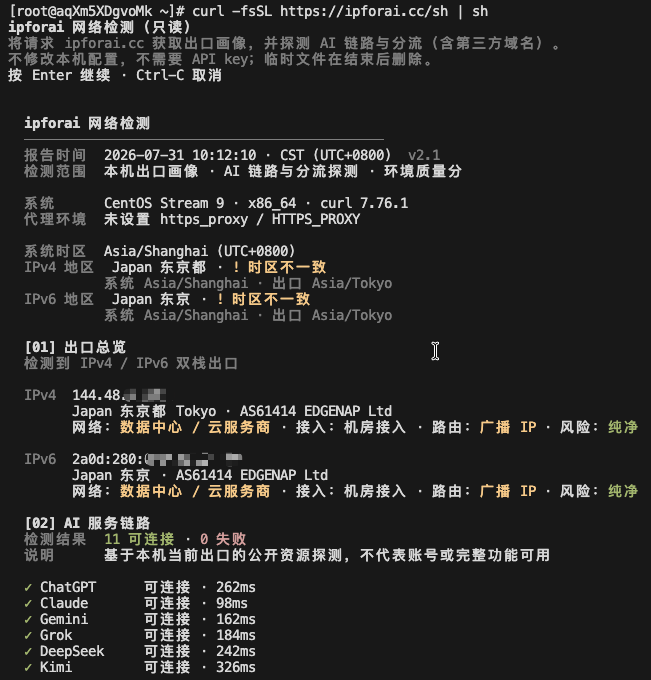
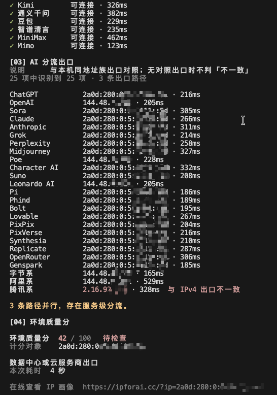

# ipforai · AI 网络环境分与出口诊断

[English](./README_EN.md) · [官网](https://ipforai.cc) · [AI 天气](https://ipforai.cc/weather) · [分流体检](https://ipforai.cc/rules) · [机房库](https://ipforai.cc/datacenters) · [终端](https://ipforai.cc/cli)

> **是我的问题，还是 AI 的问题？**

面向 **Claude、ChatGPT、Gemini、Grok** 等 AI 访问场景的网络诊断工具：打开即测各家 AI 实际看到的出口 IP、地区合规、机房/家宽属性、分流一致性、底层泄露（WebRTC / DNS & ECS / TCP 首包 / MSS / 被动 JA4 / HTTP/3 QUIC）与官方服务状态，并直接标出每一处扣分属于 **你能修**、**改分流规则** 还是 **换节点**。

结果**只描述网络环境**，不代表账号登录、订阅资格或平台风控结论。

---

## 全站入口

| 入口 | 地址 | 用途 |
| --- | --- | --- |
| 首页全套体检 | [ipforai.cc](https://ipforai.cc) | 同屏对照 Claude / ChatGPT / Gemini / Grok 实际出口、环境分与底层协议泄露 |
| 专项检测页 | [Claude](https://ipforai.cc/claude-check) · [ChatGPT](https://ipforai.cc/chatgpt-check) · [Gemini](https://ipforai.cc/gemini-check) · [Grok](https://ipforai.cc/grok-check) | 聚焦单家 AI 的网页/API 出口对照、官方状态与按症状排查 |
| AI 天气 | [ipforai.cc/weather](https://ipforai.cc/weather) | 四家官方状态、近 60 天故障记录与日本/美国/新加坡/英国/香港/台湾/大陆 7 地区 API 连通实测 |
| 分流规则体检 | [ipforai.cc/rules](https://ipforai.cc/rules) | 浏览器本地解析 Clash / Surge 规则，查 4 家 11 个关键域名是否直连、分裂或被 REJECT |
| ASN 与机房库 | [ipforai.cc/datacenters](https://ipforai.cc/datacenters) | 实时反查全球 12 万+ ASN（含 PeeringDB 规模），附高频 VPS 机房与家宽对照榜 |
| 终端守门员（CLI） | [ipforai.cc/cli](https://ipforai.cc/cli) | 纯 POSIX `sh` 只读脚本，排查 VPS、SSH 或本机 Claude Code / Codex / Gemini CLI 出口 |
| 开发者 JSON / 徽章 | [docs/api.zh.md](./docs/api.zh.md) · [docs/badge.zh.md](./docs/badge.zh.md) | `GET /json` 画像接口与 `/badge.json` / `/badge.svg` 评分徽章 |
| MCP Server | [mcp/README.md](./mcp/README.md) | 在 Claude Code、Cursor 等 AI 客户端直接查询当前或指定 IP 画像 |

---

## 一行命令（终端守门员）

本机电脑终端默认不走系统代理：测代理环境时，请先**开启代理客户端的 TUN 模式**，或使用下方第二条命令在子壳里临时传入本地代理端口。

```bash
# 1. VPS / 服务器，或本机已开 TUN 模式
curl -fsSL https://ipforai.cc/sh | sh

# 2. 本机不开 TUN，从代理视角测（7890 换成你的端口：Clash 7890 / Surge 6152 / v2rayN 10808）
(export HTTPS_PROXY=http://127.0.0.1:7890 ALL_PROXY=socks5h://127.0.0.1:7890;
  curl -fsSL https://ipforai.cc/sh | sh)

# 3. 只查指定 IP 画像与环境质量分（不测本机链路）
curl -fsSL https://ipforai.cc/sh | sh -s -- 8.8.8.8

# 4. CI / 跳过确认并展开详细诊断
curl -fsSL https://ipforai.cc/sh | sh -s -- -y -d
```

先下载审阅再执行（推荐）：

```bash
curl -fsSL https://ipforai.cc/sh -o /tmp/ipforai-check.sh
less /tmp/ipforai-check.sh
sh /tmp/ipforai-check.sh
```

> 权威脚本入口始终为 `https://ipforai.cc/sh`；本仓库中的 [`check.sh`](./check.sh) 为审阅镜像（当前版本：`v3.3`）。

### 终端输出示例





---

## 开发者 JSON（`GET /json`）

```bash
# 查看本次请求的出口画像
curl -fsSL 'https://ipforai.cc/json'

# 强制 IPv4 / IPv6
curl -4 -fsSL 'https://ipforai.cc/json'
curl -6 -fsSL 'https://ipforai.cc/json'

# 查询指定 IP（支持 CDN 缓存 600s，不对第三方暴露无参跨域）
curl -fsSL 'https://ipforai.cc/json?ip=8.8.8.8'
```

完整字段说明与稳定性承诺见 [docs/api.zh.md](./docs/api.zh.md)（[English](./docs/api.md)），示例响应见 [examples/sample.json](./examples/sample.json)。

---

## README 评分徽章

```markdown
[](https://ipforai.cc/?ip=8.8.8.8)
```

[](https://ipforai.cc/?ip=8.8.8.8)

> README 徽章必须带 `?ip=`（否则显示的是 GitHub camo 抓图服务器的分数）。详见 [docs/badge.zh.md](./docs/badge.zh.md)。

---

## MCP（AI 客户端集成）

```bash
claude mcp add ipforai -- npx -y ipforai-mcp
```

提供 `check_my_ip`（本机出口）和 `lookup_ip`（指定 IP）两个工具，支持 `HTTPS_PROXY`。详见 [mcp/README.md](./mcp/README.md)。

---

## 边界说明

- **只读检测**：CLI 不改本机配置、不装软件、不需要 API Key，临时目录退出即删。
- **不给账号承诺**：不预测账号是否被封、不提供“纯净度/防封/解锁”保证。
- **本仓库结构**：
  - `check.sh`：官网 `/sh` 审阅镜像（`v3.3`）
  - `docs/`：`/json` 与 `/badge` 接口文档
  - `mcp/`：`ipforai-mcp` npm 包源码
  - `examples/sample.json`：JSON 接口响应示例

## License

[MIT](./LICENSE)
