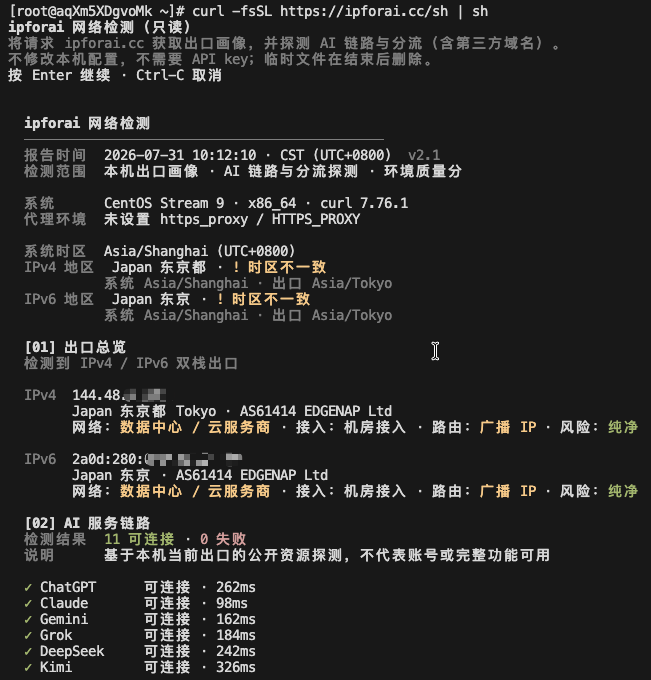
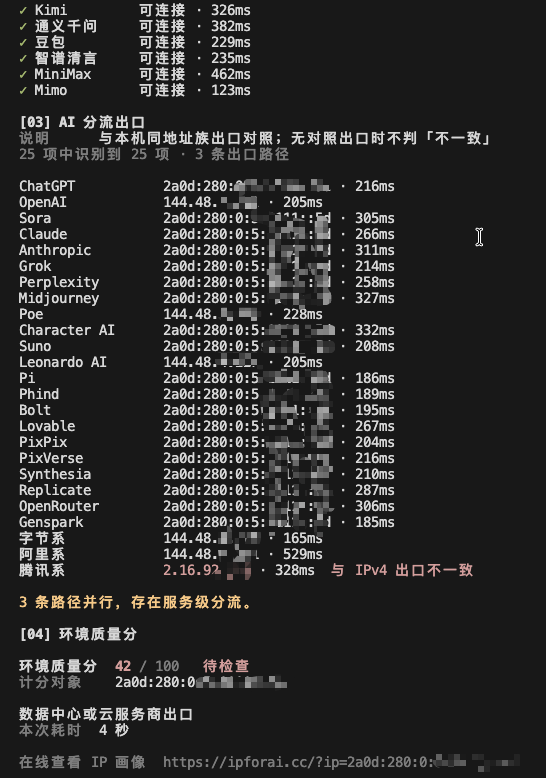

# ipforai · AI Network Environment Score & IP Diagnostics

[中文](./README.md) · [Website](https://ipforai.cc) · [AI Weather](https://ipforai.cc/weather) · [Routing Checker](https://ipforai.cc/rules) · [ASN Database](https://ipforai.cc/datacenters) · [CLI](https://ipforai.cc/cli)

Network diagnostics built for **Claude, ChatGPT, Gemini, and Grok** access: check the actual exit IP each AI service sees, region eligibility, datacenter vs. residential network profile, split-routing consistency, protocol leaks (WebRTC, DNS/ECS, TCP SYN/MSS, passive JA4, HTTP/3 QUIC), and live official service status.

Results describe the **network environment only** — not account login, subscription status, or platform risk verdicts.

---

## Entry Points

| Tool | URL | What it checks |
| --- | --- | --- |
| Full Web Dashboard | [ipforai.cc](https://ipforai.cc) | Side-by-side Claude / ChatGPT / Gemini / Grok exits, environment score, and leak checks |
| Service Check Pages | [Claude](https://ipforai.cc/claude-check) · [ChatGPT](https://ipforai.cc/chatgpt-check) · [Gemini](https://ipforai.cc/gemini-check) · [Grok](https://ipforai.cc/grok-check) | Per-service web & API exit comparison, official status, and troubleshooting guides |
| AI Weather | [ipforai.cc/weather](https://ipforai.cc/weather) | Live official status, 60-day incident history, and 7-region API reachability |
| Routing Rule Checker | [ipforai.cc/rules](https://ipforai.cc/rules) | Client-side Clash / Surge rule analyzer for 11 critical AI domains |
| ASN & Datacenter DB | [ipforai.cc/datacenters](https://ipforai.cc/datacenters) | Search 120k+ global ASNs with PeeringDB metadata and curated VPS vs. residential list |
| CLI Script | [ipforai.cc/cli](https://ipforai.cc/cli) | Read-only POSIX `sh` script for VPS, SSH, and local AI CLI tools (Claude Code / Codex) |
| Developer JSON & Badges | [docs/api.md](./docs/api.md) · [docs/badge.md](./docs/badge.md) | `GET /json` profile API and `/badge.json` / `/badge.svg` |
| MCP Server | [mcp/README.md](./mcp/README.md) | Query IP profiles directly inside Claude Code, Cursor, or any MCP client |

---

## CLI Quick Start

On a local machine, terminals ignore the OS system proxy by default. Either enable **TUN mode** in your proxy client, or pass your local proxy port in a subshell so both `curl` and `sh` use it:

```bash
# 1. VPS / server, or local terminal with TUN mode enabled
curl -fsSL https://ipforai.cc/sh | sh

# 2. Local terminal without TUN (replace 7890 with your proxy port)
(export HTTPS_PROXY=http://127.0.0.1:7890 ALL_PROXY=socks5h://127.0.0.1:7890;
  curl -fsSL https://ipforai.cc/sh | sh)

# 3. Profile a specific IP only (skips local probes)
curl -fsSL https://ipforai.cc/sh | sh -s -- 8.8.8.8

# 4. Non-interactive / detailed mode
curl -fsSL https://ipforai.cc/sh | sh -s -- -y -d
```

Review before running (recommended):

```bash
curl -fsSL https://ipforai.cc/sh -o /tmp/ipforai-check.sh
less /tmp/ipforai-check.sh
sh /tmp/ipforai-check.sh
```

> Canonical script URL: `https://ipforai.cc/sh`. [`check.sh`](./check.sh) in this repo is a review mirror (`v3.3`).





---

## Developer JSON (`GET /json`)

```bash
curl -fsSL 'https://ipforai.cc/json'
curl -4 -fsSL 'https://ipforai.cc/json'
curl -6 -fsSL 'https://ipforai.cc/json'
curl -fsSL 'https://ipforai.cc/json?ip=8.8.8.8'
```

See [docs/api.md](./docs/api.md) and [examples/sample.json](./examples/sample.json).

---

## README Badge & MCP

```markdown
[](https://ipforai.cc/?ip=8.8.8.8)
```

```bash
claude mcp add ipforai -- npx -y ipforai-mcp
```

Details: [docs/badge.md](./docs/badge.md) · [mcp/README.md](./mcp/README.md).

---

## License

[MIT](./LICENSE)
